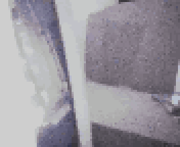
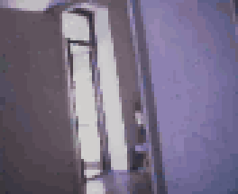
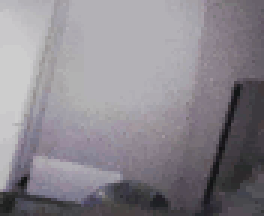

# vgpx-decoder

This is a decoder for Alaris VGPixel video, the webcam format stored in AVI files under the fourcc `VGPX`. FFmpeg recognizes the tag but has no decoder for it, so these files would not play without the original Windows codec.

**Flicker warning:** the first GIF below flickers. It shows a computer monitor filmed by the webcam.





These frames come from a clip recorded in July 2000 and decoded with this tool. The camera recorded at 88×72 pixels, and the GIFs show it at three times that size.

## The backstory

Around 2000, at my first job somewhere in Eastern Europe, I had a cheap webcam to play with. Its software saved clips in the Alaris VGPixel format. A few of those clips survived, and for years nothing could play them.

In 2026 I asked Claude, Anthropic's AI model, to try. It started from Kostya Shishkov's write-up of the format, worked out the details the write-up left open by testing against my clips, and wrote this decoder. It never ran the original Windows codec. Every clip came back whole, picture and sound, so I'm sharing the decoder in case anyone else has old VGPX files waiting on a drive.

## Using it

The decoder is a single Python 3 file with no dependencies. Writing MKV or MP4 also needs [ffmpeg](https://ffmpeg.org) on the path.

```
python3 vgpx.py clip.avi clip.mkv     # lossless FFV1 video at the original size, original PCM audio
python3 vgpx.py clip.avi clip.mp4     # H.264 scaled up 4x for easy viewing, audio as Apple Lossless
python3 vgpx.py clip.avi clip.y4m     # raw YUV 4:4:4 frames, no audio, no ffmpeg needed
python3 vgpx.py --info clip.avi       # size, frame rate, frame counts, and whether every packet decoded cleanly
```

The decoder is plain Python, so it is slow, but these clips are tiny. `vgpx.py` can also be imported: `Clip(path).frames()` yields each frame as planar Y, Cb, Cr bytes.

## Sample files

`samples/` holds three short VGPX files cut from the original July 2000 recording, the same stretches as the GIFs above: `monitor.avi` (12 seconds), `poster.avi` (4.5 seconds) and `cd-box.avi` (5.4 seconds). Each one starts on a key frame, and its video packets are copied byte for byte from the original file. The sound was left out. The FFmpeg sample archive has no VGPX file, so these may be the only public ones. Anyone writing another decoder is welcome to use them.

## How the format works

Each frame is a stream of short codes, one per operation. An operation either copies a neighboring pixel (left, top, right or bottom), averages two neighbors, skips pixels that have not changed since the last frame, repeats the left pixel a few times, or adds an explicit difference to all three color components. The operation codes and the difference codes come from fixed tables, which are printed on the [MultimediaWiki page](https://wiki.multimedia.cx/index.php/Alaris_VideoGramPiX). Kostya Shishkov described the codec on his blog in [Alaris VGPixel](https://codecs.multimedia.cx/2021/01/alaris-vgpixel/) (January 2021).

The wiki tables are right, but decoding real files needed nine further facts, which came from testing against the clips:

1. The bits are read least-significant first, starting at byte 4 of each packet. The wiki's code strings are correct when read right to left. Packets are padded to a multiple of 16 bits.
2. Byte 0 is `0x01` for a key frame and `0x00` for every other frame. The wiki lists `0x08` for key frames, and no other values occurred in these files. An empty packet means "show the previous frame again".
3. Bytes 1 to 3 hold the three components of the first pixel. The wiki guessed they gave a component order. The codes start at the second pixel and run through the frame top to bottom in one pass, with no flip.
4. The run lengths for "skip N pixels" and "repeat N times" sit in bytes 4 and 5 of the 32 bytes of extra data after the bitmap header, not in bytes 32 and 33. Both were 4 in these files, which selects the wiki's second pair of operation tables.
5. In the difference table for the second and third components, values up to 128 mean the value minus 128, and values above 128 mean the value minus 192, so 200 means +8 and 248 means +56. The first component's table is a plain offset of 128 in steps of 8.
6. In the first column, a difference is added to black (0, 128, 128), not to the last pixel of the row above. Everywhere else it is added to the pixel on the left, in key frames and other frames alike. Before this was found, the brightness of key frames swung by about 20 levels from one to the next.
7. Results are clamped to 0–255 on the decoded components themselves, before any conversion to RGB.
8. The encoder never refers to a pixel outside the frame. In frames other than key frames, "right" and "bottom" read the previous frame, because those pixels have not been redrawn yet. Averages round down.
9. The three components are one brightness channel and two color differences centered on 128, the first bluish and the second reddish. The exact conversion to RGB cannot be pinned down from these clips. The decoder treats them as full-range BT.601 Y, Cb and Cr, which gives natural skin tones.

## Limits

- Four clips from one camera, at 88×72 and 176×144 pixels, are the only real files this was tested on. The format has header flags that none of them used (an alternative code table, interlacing, upside-down frames). The decoder stops with an error on those rather than guess.
- The color conversion in point 9 is the best fit to the clips, not a documented fact.
- At each key frame the picture changes a little more than it does between ordinary frames, about 1.5 to 2 times as much. Ordinary frames look clean, so the encoder most likely lets small errors build up between key frames. This has not been confirmed.
- The tests in `tests/` do two things. They decode the three samples and check that every frame matches the output recorded when the full clips were checked by eye. They also encode synthetic frames with a small encoder and check that the decoder returns them exactly. Run them with `python3 -m unittest discover tests`.

## Credits

Kostya Shishkov reverse-engineered VGPixel and published its structure and code tables. Claude, by Anthropic, wrote the decoder in 2026 and found the facts listed above. The code tables are reproduced from MultimediaWiki, whose text is under the GNU Free Documentation License.

## License

MIT. See `LICENSE`.
